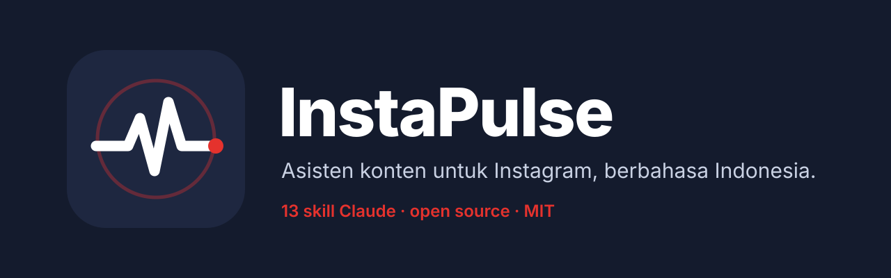

<p align="center">
  
</p>

# InstaPulse

**Asisten konten untuk Instagram, berbahasa Indonesia.** Tiga belas skill Claude
yang menulis naskah Reels, caption, carousel, story, komen, balasan dan DM,
menilai hook sebelum kamu merekam, merencanakan minggumu, dan membedah
Insights-mu, dengan bahasa, budaya, dan kebiasaan penonton Indonesia.

**Tidak ada yang diposting sebelum kamu bilang ya.** InstaPulse menulis.
Kamu yang posting.

> **Cara pakai lengkap ada di [PANDUAN.md](PANDUAN.md).**

```
/plugin marketplace add faavha/InstaPulse.ai
/plugin install instapulse@instapulse
```

Lalu cukup minta dengan bahasa biasa: *"bikinin naskah reels soal ..."*,
*"balasin komen-komen ini"*, *"rencanain minggu depan"*.

InstaPulse adalah adaptasi dari
[instagram-agent-skill](https://github.com/Jakeschincariol/instagram-agent-skill)
karya Jake Schincariol (MIT), ditulis ulang untuk bahasa Indonesia.

## Apa yang berbeda dari versi aslinya

| bagian | versi asli | versi ini |
| --- | --- | --- |
| Durasi naskah | jumlah kata x 165 kata/menit (laju bahasa Inggris) | **suku kata** per detik, angka dihitung seperti diucapkan ("Rp4.500.000" = 13 suku kata), bisa dikalibrasi dengan `--kalibrasi` |
| Skor hook | kosakata Inggris; "Halo guys, hari ini aku mau bahas..." lolos tanpa tanda fatal | sapaan, salam, "di video kali ini", "jangan scroll", "tonton sampai habis" ditandai; penanda angka/rupiah/taruhan/kata ganti bahasa Indonesia |
| Formula hook | 26, bahasa Inggris | 26 diterjemahkan + 3 khas Reels Indonesia: **#27 Ternyata, #28 POV, #29 Spill**; classifier dua bahasa |
| Humanizer | 154 klise bahasa Inggris | + 120 "bahasa AI" Indonesia ("di era digital seperti sekarang ini", "krusial", "oleh karena itu", "semoga bermanfaat") dan 16 pola struktural ("bukan sekadar X, tapi Y", "Hasilnya?", "Halo sobat...!") |
| Detektor | menghitung kontraksi Inggris (don't, it's) | menghitung penanda lisan (nggak, udah, sih, banget) dan menghukum register kaku (Anda, merupakan, tersebut) di akun santai; `--register formal` untuk akun institusi |
| Bug emoji | 👨‍💻 pecah jadi 👨💻 (zero-width joiner dihapus) | emoji gabungan dan bendera dipertahankan |
| Angka di swipe file | "1,2jt" terbaca 12 | "412rb", "1,2jt", "48.000", "12,5K" terbaca benar; header kolom boleh bahasa Indonesia |
| Caption | CTA bahasa Inggris | CTA Indonesia ("komen MAU", "cek link di bio"), hashtag generik lokal (#fypシ, #viralindonesia), sapaan di baris pertama ditandai |
| Konteks | AS | rupiah, WIB/WITA/WIT, gajian, Ramadan, Harbolnas, "harga berapa kak?", spam judi online, sapaan "Kak", link WhatsApp, label Paid Partnership, SARA/UU ITE |

## Ketiga belas skill

| perintah | fungsinya |
| --- | --- |
| `/ig-reel` | Satu ide jadi Reel. Tiga hook dari 29 formula, diskor, lalu naskah, teks layar dan beat sheet berwaktu. |
| `/ig-viral` | Mencari yang jalan di niche-mu, mengurutkan berdasarkan kelipatan terhadap median akunnya sendiri, menamai formulanya, menulis swipe file. |
| `/ig-caption` | Caption yang dicek linter. Menunjukkan 125 karakter yang tampil sebelum "... selengkapnya". |
| `/ig-carousel` | Postingan geser. Cover, teks per slide, file 1080x1350. |
| `/ig-story` | Urutan story harian, stiker mana untuk apa, dan funnel DM di mana mereka yang bergerak duluan. |
| `/ig-profile` | Skor profil dari 100 dengan rubrik 12 bagian, lalu tulis ulang mulai dari yang paling banyak kehilangan poin. |
| `/ig-plan` | Rencana seminggu: apa, format, jam (zona audiens), momen lokal, dan 10 akun untuk engagement. |
| `/ig-human` | Humanizer. Dua script yang benar-benar jalan. |
| `/ig-comment` | Komen di post orang lain. Sembilan jenis. Tidak pernah "mantap kak 🔥". |
| `/ig-reply` | Kolom komen post sendiri. Dipilah, lalu ditulis sesuai urutan nilainya. |
| `/ig-dm` | Pengiriman kata kunci, pesan pertama, pitch kolab, dan dua follow-up. Dua. |
| `/ig-repurpose` | Satu video, podcast, live atau artikel jadi seminggu Reels dan carousel. |
| `/ig-audit` | Bedah konten yang sudah diposting. Diurutkan berdasarkan outlier multiple dan kirim per jangkauan, bukan views. |

## Script yang benar-benar jalan

Tanpa dependensi, tanpa jaringan, tidak ada yang diunggah. Butuh Python 3.

```bash
# ig-reel
python3 hookscore.py hooks.txt                  # urutkan opsi hook
python3 beats.py naskah.txt --target 30         # beat sheet sebelum rekam
python3 beats.py naskah.txt --kalibrasi 27.5    # hitung laju bicaramu

# ig-caption
python3 caption.py caption.txt --keywords "foto produk,jualan online"

# ig-human
python3 humanize.py draf.txt -o bersih.txt --report
python3 detect.py draf.txt bersih.txt

# ig-viral (butuh folder ig-reel di sebelahnya)
python3 swipe.py tangkapan.tsv --out ~/.claude/instagram/swipe.md
```

Contoh nyata dari `hookscore.py`:

```
PERINGKAT HOOK
->  82.7 KUAT   Nggak ada yang bilang 30 Reels pertamamu memang bakal sepi.
        terlemah: TARUHAN (70)
    63.7 OKE    Gaji ASN 4 juta, tapi aku bangun panel surya 3kW sendiri.
        terlemah: PANJANG (44)
    32.4 LEMAH  Di video kali ini aku mau kasih tau tips jualan online
        terlemah: TARUHAN (20)
        fatal: Basa-basi pembuka video. Hapus, langsung buka dengan inti/hasilnya.
     0.0 LEMAH  Halo guys, hari ini aku mau bahas tentang solar panel
        terlemah: DI DEPAN (0)
        fatal: Basa-basi pembuka video. Hapus, langsung buka dengan inti/hasilnya.
        fatal: Sapaan. Salam boleh, tapi taruh SETELAH hook. Detik pertama milik hook.
```

## Pasang

Di Claude Code:

```
/plugin marketplace add faavha/InstaPulse.ai
/plugin install instapulse@instapulse
```

Atau salin manual:

```bash
git clone https://github.com/faavha/InstaPulse.ai.git
cp -r InstaPulse.ai/skills/ig-* ~/.claude/skills/
```

Salin semua folder `ig-*` sekaligus: `ig-viral` memakai script dan
`hooks.json` dari `ig-reel`.

## Mulai

Setelah plugin terpasang, isi profil suaramu sekali. Templatnya ada di
`skills/ig-reel/voice-template.md`; salin ke `~/.claude/instagram/voice.md`,
atau kirim tiga Reels/caption-mu ke Claude dan bilang "tulisin voice.md-ku
dari ini". Semua skill membacanya.

File kerja (voice.md, swipe.md, plan.md, log.md) disimpan di
`~/.claude/instagram/`.

## Batasan yang jujur

- Skor hook dan detektor AI adalah heuristik. Ambang batasnya berasal dari
  versi asli bahasa Inggris dan **belum dikalibrasi pada data Indonesia**.
  Pakai sebagai checklist, bukan ramalan views atau jaminan "lolos detektor".
- Laju bicara default 5,5 suku kata/detik adalah titik awal. Kalibrasi dengan
  suaramu sendiri.
- Fakta platform (batas 5 hashtag sejak 18 Desember 2025, batas caption 2.200
  karakter) benar per November 2026 dan bisa berubah.

## Catatan merek

InstaPulse adalah proyek open source independen dan **tidak berafiliasi,
didukung, atau disponsori oleh Meta Platforms atau Instagram**. "Instagram"
adalah merek dagang Meta Platforms, Inc., dan disebut di sini hanya untuk
menjelaskan bahwa skill ini dipakai untuk konten Instagram. Logo InstaPulse
adalah desain sendiri dan tidak memakai aset merek Instagram.

## Lisensi

MIT. Lihat `LICENSE`. Hak cipta asli tetap milik Jake Schincariol.
